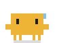
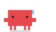
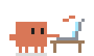

# Context Clawd

A pixel Claude that sits above the prompt in Claude Code and shows how full the context window is.

<p align="center">
  
  &nbsp;&nbsp;&nbsp;&nbsp;
  
</p>

Next to the sprite the band reads `312k / 1M · 31%` above a 40-segment bar, so you can tell at a glance how much room is left before the context gets heavy.

## Levels

The color follows how much of the model's context window the last reply was answered over.

| Level | Share of the window | On a 1M window | |
| --- | --- | --- | --- |
| Orange | under 30% | under 300k |  |
| Yellow | 30% to 50% | 300k to 500k |  |
| Red | over 50% | over 500k |  |

On a 200k window the same shares come to 60k and 100k.

- Crossing into yellow plays a one-off alert: two jumps, a flash into the new color and a `!`.
- Crossing into red shakes Clawd and shows `!!`.
- From yellow on, Clawd sweats. Past red its eyes half close and it slows down.
- Before the first reply of a session, and after `/clear` or a compaction, the band reads `new context` and Clawd works in orange.

## Sets

Each session picks one of two sets at random and keeps it until the session ends.

| Set | Idle | Working | Hits 300k | Hits 500k |
| --- | --- | --- | --- | --- |
| classic |  |  |  |  |
| play |  |  |  |  |

- **classic**: Clawd from the front. It hops and blinks while idle, and marches beside a twinkling ✻ while the model works.
- **play**: Clawd from the side. It juggles a ball while idle (two kicks, then a header), and types at a laptop while the model works.

The alerts above loop so you can see them; in the band each one plays once.

## Install

At the prompt of a Claude Code terminal session:

```
/plugin install context-clawd --marketplace mihajloS/context-clawd
```

Answer `y` to add the marketplace, then pick a scope (the user scope loads it in every session).

From a shell:

```bash
claude plugin install context-clawd --marketplace mihajloS/context-clawd
```

In the desktop app, where `/plugin` does not run: click **+** next to the prompt box, then **Plugins**, **Add marketplace** with `mihajloS/context-clawd`, then **Add plugin**. A mod installed from a terminal at the user scope also loads in the desktop app's Code tab.

## What it costs

Nothing in the context window and no API calls. The mod reads the figures Claude Code already holds from the last API response, the same ones the status line shows, every 1.5 seconds on your machine. It registers no tools, skills or commands, so it adds nothing to the system prompt.

## Where it draws

The animated band draws in the Code tab of the Claude desktop app. In a terminal session the band is one line of text:

```
▐▛███▜▌  312k / 1M · 31%  ▰▰▰▰▰▰▰▱▱▱▱▱▱▱▱▱▱▱▱▱
```

## Requirements

Context Clawd is built on Claude Code's function-hooks plugin API, which is in early access and can change between releases. It was written against Claude Code 2.1.309.

## Development

| File | What it holds |
| --- | --- |
| `hooks/register.tsx` | Reads the context usage, picks the session's set, draws the band |
| `hooks/classic.ts`, `hooks/play.ts` | The two sprite sets |
| `hooks/pixels.ts` | Level colors and the SMIL frame helpers both sets draw with |
| `hooks/art.ts` | The thresholds, the list of sets and the segmented bar |
| `assets/` | The SVGs in this README, rendered from the sets |

```bash
claude plugin validate .
claude plugin test .
```

To add a set, write a file that exports a `SpriteSet`, add it to `SETS` and `SET_ORDER` in `hooks/art.ts`, and add its id to `ClawdSetId` in `types/index.d.ts`.

---

MIT licensed. The pixel character is Claude Code's mascot. Context Clawd is an unofficial mod, not made or endorsed by Anthropic.
